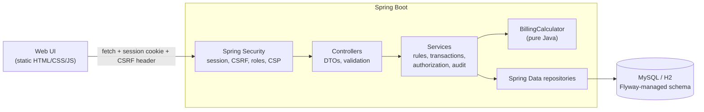
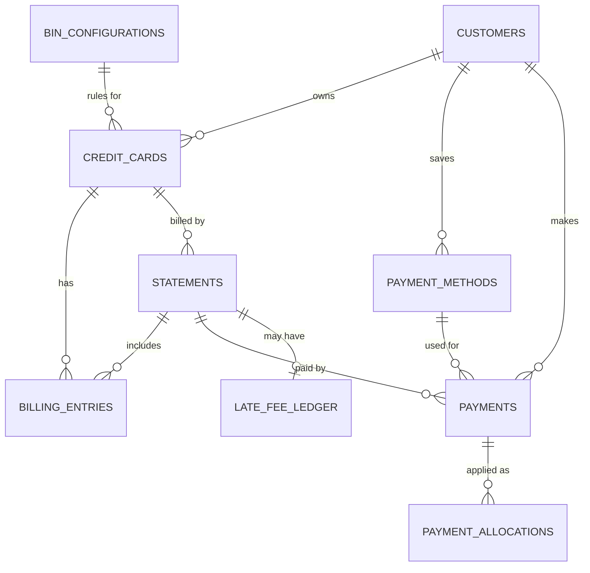
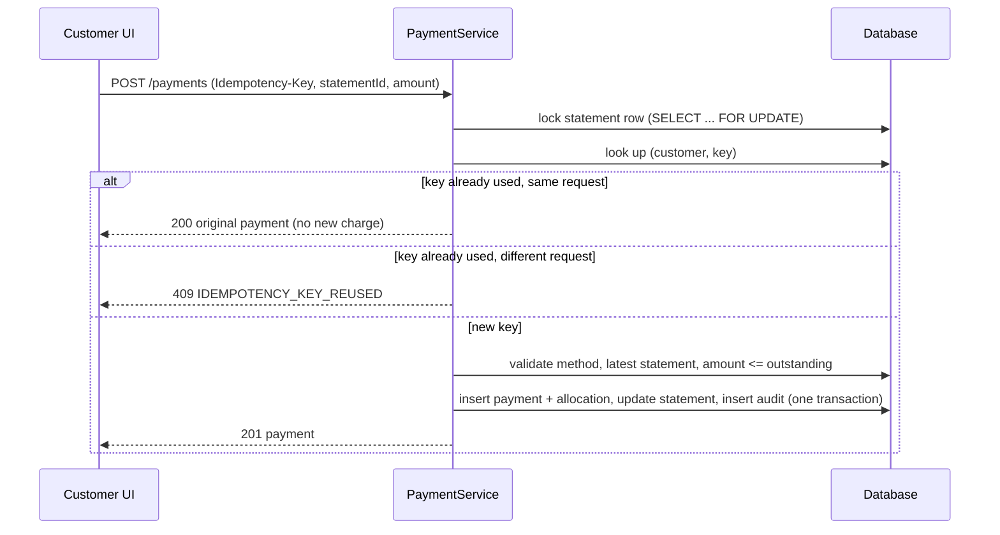

# Credit Card Billing & Statement Management System


A full-stack credit card billing platform: customers and administrators, card lifecycle, configurable BIN-level billing rules, statement generation with finance charges and GST, late fees, simulated payments with idempotency, and an append-only audit trail.

The backend is Spring Boot (Spring Data JPA/Hibernate, Spring Security, Flyway, MySQL/H2). The web UI is plain HTML/CSS/JavaScript served by the same Spring Boot process, so there is **no Node, no build step and no framework** to install.

> **Scope:** educational portfolio project. All card data is synthetic, payments are simulated, and there is no card-network or payment-gateway integration. It is **not** PCI DSS compliant and has not been externally audited.

## Screenshots

> Screenshots live in `docs/screenshots/`.

| Sign in | Customer overview |
|---|---|
|  |  |

| Statement breakdown | Pay a statement |
|---|---|
|  |  |

| Admin overview | BIN billing rules |
|---|---|
|  |  |

| Card management | Audit log |
|---|---|
|  |  |

## Table of contents
- [Features](#features)
- [Engineering highlights](#engineering-highlights)
- [Tech stack](#tech-stack)
- [Architecture](#architecture)
- [Quick start](#quick-start)
- [Using the web UI](#using-the-web-ui)
- [Configuration](#configuration)
- [Running with MySQL](#running-with-mysql)
- [REST API](#rest-api)
- [Billing rules and formulas](#billing-rules-and-formulas)
- [Security model](#security-model)
- [Testing](#testing)
- [Project structure](#project-structure)
- [Troubleshooting](#troubleshooting)
- [Limitations and roadmap](#limitations-and-roadmap)
- [Project status](#project-status)
- [Author](#author)

## Features

**Customers**
- Self-registration and sign-in, profile editing
- Card overview with credit usage, per-card balance and transaction history
- Statements with a full breakdown: previous balance, purchases, fees, finance charge, GST, credits, minimum due
- Pay a statement (minimum, full or custom amount); retries can never double-charge
- Manage saved payment methods, view payment history and late-fee ledger

**Administrators**
- Manage customers (enable/disable) and other administrator accounts
- Create and edit **BIN billing rules** (cycle day, due days, minimum-due rule, finance charge, GST, late-fee rule), each change versioned
- Issue cards; block, unblock or close them; change credit limits
- Post simulated transactions (purchase, fee, refund) with credit-limit checks
- Generate statements, assess late fees, reverse payments
- Searchable, append-only audit log

**Platform**
- Session-based authentication, role-based authorization, CSRF protection
- Flyway-managed schema, identical SQL on MySQL and H2
- 40+ REST endpoints with validation, pagination and consistent error responses

## Engineering highlights

| Area | What was done |
|---|---|
| **Money correctness** | All amounts are `BigDecimal`, scale 2, `HALF_UP`, rounded once per derived amount. Formulas live in one framework-free class (`BillingCalculator`) with boundary tests. |
| **Configurable rules + history** | Billing rules are stored per BIN and versioned. Each statement stores a **snapshot** of the rules it was generated with, so changing a BIN later never alters past statements or late-fee calculations. |
| **Idempotent payments** | `Idempotency-Key` header plus a request fingerprint: same key and body returns the original payment; same key with a different body is rejected. A unique `(customer, key)` constraint is the database backstop. |
| **Concurrency** | Pessimistic row locks serialize operations on a card (entries, statement generation) and on a statement (payments, reversals, late fees). Unique constraints back every duplicate-protection rule. |
| **Atomicity** | Payment row, allocation row, statement balance and audit record commit or roll back together. |
| **Append-only records** | Audit log, late-fee ledger and payment allocations have no update/delete methods, are `@Immutable` in Hibernate, and have MySQL triggers (plus optional grants) as a database-level guard. Reversals are new negative rows, never edits. |
| **Security** | BCrypt (delegating encoder), session-fixation protection, CSRF tokens, HttpOnly + SameSite=Strict cookie, URL-level and service-level (`@PreAuthorize`) checks, customer isolation by session id (other customers' ids return 404), generic login errors, strict Content-Security-Policy, no inline scripts, UI renders API data as text only. |
| **Sensitive data** | Full card numbers are never stored or logged: only a masked form, last 4 digits and a SHA-256 hash. Payment identifiers are stored masked. Passwords never appear in responses or audit records. |
| **Schema discipline** | Flyway owns the schema; Hibernate runs with `ddl-auto=validate`. Foreign keys, unique and check constraints act as a second line of defence behind service validation. |

## Tech stack

| Layer | Technology |
|---|---|
| Language | Java 17+ (developed and tested on JDK 21) |
| Framework | Spring Boot 3.3.5, Spring MVC, Spring Data JPA (Hibernate 6.5), Spring Security 6.3, Bean Validation |
| Database | MySQL 8 (persistent profile), H2 2.2 in MySQL mode (default, in-memory) |
| Migrations | Flyway 10 |
| Testing | JUnit 5, Mockito, Spring Boot Test / MockMvc |
| Frontend | Vanilla JavaScript (ES modules), HTML, CSS, no build tooling |
| Build | Maven 3.6.3+ |

Dependencies are managed by the Spring Boot BOM. Run `mvn dependency:tree` for exact resolved versions.

## Architecture



Layers: **controllers** (thin, DTOs only) → **services** (business rules, transactions, authorization, auditing) → **repositories** → **entities**. Constructor injection throughout; JPA entities are never exposed in API responses.

### Data model



Also: `administrators` (separate login table) and `audit_logs` (append-only, references entities by type and id). 11 tables in total; see `src/main/resources/db/migration/V1__initial_schema.sql`.

### Payment flow



## Quick start

**Prerequisites:** JDK 17 or newer and Maven 3.6.3+ (`java -version`, `mvn -version`). No database installation is needed for the default profile.

```bash
git clone https://github.com/omkumars31/credit-card-management-system.git
cd credit-card-management-system
mvn clean test          # optional: runs all 148 tests
mvn spring-boot:run
```

Open **http://localhost:8080**.

On first start the console prints a one-time administrator login:

```
 LOCAL DEV ONLY - generated one-time administrator credentials
   username: admin
   password: ...
```

Copy the password. Default storage is an in-memory H2 database, so **all data and the generated password reset on every restart**. To choose your own administrator credentials:

```bash
BOOTSTRAP_ADMIN_USERNAME=admin BOOTSTRAP_ADMIN_PASSWORD='a-long-passphrase-123' mvn spring-boot:run
```

PowerShell: `$env:BOOTSTRAP_ADMIN_USERNAME="admin"; $env:BOOTSTRAP_ADMIN_PASSWORD="a-long-passphrase-123"; mvn spring-boot:run`

## Using the web UI

1. On the sign-in page choose **Customer** and click *Create an account*, then sign out.
2. Sign in on the **Administrator** tab with `admin` and the console password.
3. **Cards → Issue card** for your customer, then open the card.
4. **Post transaction** a few times (purchases, a refund).
5. **Generate statement**. The period end defaults to the latest billing-cycle day, which must already have passed.
6. Sign in as the customer: **Statements → Pay**. Try a partial payment, then view the breakdown.
7. Back as admin: check **Audit log**, **Payments** (reversal) and **Late fees**. Late fees and finance charges need a due date to pass, so they appear in the automated tests (which control the clock) rather than a live demo.

## Configuration

Spring Boot does not read `.env` files; export variables in your shell or IDE run configuration. `.env.example` lists them all.

| Variable | Purpose | Default |
|---|---|---|
| `SPRING_PROFILES_ACTIVE` | `h2` or `mysql` | `h2` |
| `SERVER_PORT` | HTTP port | `8080` |
| `BOOTSTRAP_ADMIN_USERNAME` / `BOOTSTRAP_ADMIN_PASSWORD` | Initial administrator (password 12+ chars); created only if it does not exist | random one-time password on the H2 profile |
| `H2_URL` | e.g. `jdbc:h2:file:./data/ccbilling;MODE=MySQL` to persist H2 data | in-memory |
| `DB_URL`, `DB_USERNAME`, `DB_PASSWORD` | MySQL connection (mysql profile) | local MySQL, user `ccbilling`, empty password |
| `FLYWAY_LOCATIONS` | Set to `classpath:db/migration` to skip the MySQL-only triggers | both folders |
| `SESSION_COOKIE_SECURE` | Set `true` when served over HTTPS | `false` |

## Running with MySQL

```sql
CREATE DATABASE ccbilling CHARACTER SET utf8mb4;
CREATE USER 'ccbilling'@'localhost' IDENTIFIED BY '<your-local-password>';
GRANT ALL PRIVILEGES ON ccbilling.* TO 'ccbilling'@'localhost';
```

```bash
export SPRING_PROFILES_ACTIVE=mysql
export DB_USERNAME=ccbilling
export DB_PASSWORD='<your-local-password>'
export BOOTSTRAP_ADMIN_USERNAME=admin
export BOOTSTRAP_ADMIN_PASSWORD='<12+ character passphrase>'
mvn spring-boot:run
```

With the `mysql` profile Flyway also applies `db/migration-mysql/V100__append_only_triggers.sql` (blocks UPDATE/DELETE on `audit_logs`, `late_fee_ledger`, `payment_allocations`). It needs the `TRIGGER` privilege and, with binary logging enabled, `SUPER` or `log_bin_trust_function_creators=1`; skip it with `FLYWAY_LOCATIONS=classpath:db/migration`. The default `DB_URL` uses `useSSL=false` and `allowPublicKeyRetrieval=true`, which are for local development only.

> The MySQL profile and its triggers have not been exercised yet (see [Project status](#project-status)).

## REST API

All endpoints return JSON. Lists are paginated (`?page=0&size=20&sort=field,desc`, max size 100). Errors have the shape `{timestamp, status, code, message, path, fieldErrors?}`. Money values are numbers with 2 decimals (INR); dates are ISO-8601 (UTC).

**Public:** `GET /api/health`, `GET /api/auth/csrf`, `POST /api/auth/register`, `POST /api/auth/login`, `POST /api/auth/logout`, `GET /api/auth/me`

**Customer** (`/api/customers/me/...`, role `CUSTOMER`):

| Endpoint | Description |
|---|---|
| `GET`, `PUT /api/customers/me` | Profile |
| `GET .../cards`, `.../cards/{id}`, `.../cards/{id}/balance`, `.../cards/{id}/entries` | Own cards, balance, transactions |
| `GET .../statements`, `.../statements/{id}` | Own statements |
| `POST .../payments` (header `Idempotency-Key`), `GET .../payments`, `.../payments/{id}` | Pay and list payments |
| `GET`, `POST .../payment-methods`, `DELETE .../payment-methods/{id}` | Saved methods (deactivate) |
| `GET .../late-fees` | Late-fee ledger |

**Administrator** (`/api/admin/...`, role `ADMIN`):

| Endpoint | Description |
|---|---|
| `/administrators` (POST, GET), `/administrators/{id}/enabled` (PATCH) | Admin accounts |
| `/customers`, `/customers/{id}`, `/customers/{id}/status` | Customers |
| `/bin-configurations` (POST, GET), `/bin-configurations/{id}` (GET, PUT) | Billing rules |
| `/cards` (POST, GET), `/cards/{id}`, `/cards/{id}/status`, `/cards/{id}/credit-limit`, `/cards/{id}/balance` | Card lifecycle |
| `/cards/{id}/entries` (POST, GET) | Post and list transactions |
| `/statements/generate`, `/statements`, `/statements/{id}` | Statements |
| `/statements/{id}/late-fee` (POST), `/late-fees` (GET) | Late fees and ledger |
| `/payments` (GET), `/payments/{id}/reverse` (POST) | Payments and reversal |
| `/audit-logs` | Filter by action, entity, actor, time range |

Status codes: `201` created, `204` logout, `400` validation, `401` unauthenticated, `403` forbidden or CSRF, `404` not found (including other customers' ids), `409` conflict or duplicate, `422` business-rule violation (e.g. `CREDIT_LIMIT_EXCEEDED`, `PAYMENT_EXCEEDS_OUTSTANDING`).

<details>
<summary><b>Example: generate a statement</b></summary>

`POST /api/admin/statements/generate` with `{"cardId": 1, "periodEnd": "2026-03-15"}`:

```json
{
  "id": 1, "cardId": 1, "maskedCardNumber": "412345******8812",
  "periodStart": "2026-02-16", "periodEnd": "2026-03-15", "dueDate": "2026-04-04",
  "previousBalance": 0.00, "purchasesTotal": 12500.50, "creditsTotal": 500.50, "feesTotal": 0.00,
  "financeCharge": 0.00, "gstOnFinanceCharge": 0.00,
  "totalAmountDue": 12000.00, "minimumAmountDue": 600.00,
  "paidAmount": 0.00, "outstandingAmount": 12000.00,
  "paymentStatus": "UNPAID", "ruleVersion": 1, "rulesApplied": { "...": "snapshot of the BIN rules" }
}
```
Repeating the call returns `409 STATEMENT_ALREADY_EXISTS` and creates no charges.
</details>

<details>
<summary><b>Example: call the API with curl (CSRF + session)</b></summary>

```bash
BASE=http://localhost:8080; JAR=$(mktemp)
csrf() { curl -s -b "$JAR" -c "$JAR" $BASE/api/auth/csrf | sed -E 's/.*"token":"([^"]+)".*/\1/'; }
api()  { curl -s -b "$JAR" -c "$JAR" -H "X-CSRF-TOKEN: $(csrf)" -H 'Content-Type: application/json' "$@"; }

api -X POST $BASE/api/auth/login -d '{"userType":"ADMIN","identifier":"admin","password":"<console password>"}'
api $BASE/api/admin/bin-configurations
```
</details>

## Billing rules and formulas

Currency is INR. Rounding is `HALF_UP` at 2 decimals. Business "today" is the UTC date.

```
financeCharge      = round2( max(0, previousBalance) × monthlyRate / 100 )
gstOnFinanceCharge = round2( financeCharge × gstRate / 100 )
totalAmountDue     = previousBalance + purchases + fees + financeCharge + gstOnFinanceCharge − credits
minimumAmountDue   = 0                                  if totalAmountDue ≤ 0
                   = totalAmountDue                     if totalAmountDue ≤ minDueFloor
                   = min(total, max(minDueFloor, round2(total × minDuePct / 100)))   otherwise
lateFee            = 0                                  if unpaidMinimumDue ≤ 0 or total < lateFeeThreshold
                   = min(cap, max(floor, round2(unpaidMinimumDue × lateFeePct / 100)))
lateFee posted     = lateFee + round2(lateFee × gstRate / 100)
```

**Worked example** (rules: 5% minimum due with 200 floor, 3.5% monthly finance charge, 18% GST, late fee 10% within 100–1000): statement 1 totals ₹12,000.00 with minimum due ₹600.00. The customer pays ₹300 by the due date, which is less than the minimum, so a late fee of ₹100.00 + ₹18.00 GST = ₹118.00 is assessed. Statement 2 then carries ₹11,700.00, adds a ₹409.50 finance charge, ₹73.71 GST on it, the ₹118.00 late fee and ₹1,000.00 of new purchases: total **₹13,301.21**, minimum due **₹665.06**. This exact scenario is an automated test.

**Design decisions and assumptions**
- **Billing period:** closes on the BIN's `billingCycleDay` (1–28). `periodEnd` must be that day, not in the future, later than the card's latest statement, and not before the card was opened. Due date is `periodEnd + paymentDueDays` (at most 27).
- **Cumulative statements:** the previous statement's outstanding amount is carried forward; finance charge applies to that unpaid amount. A credit balance is carried forward and earns no finance charge.
- **Payments:** only against the card's latest statement; cannot exceed the outstanding amount; completed immediately (simulated).
- **Late fee:** assessed by an administrator (no scheduler) once the due date has passed and net on-time payments are below the minimum due; uses the statement's rule snapshot; at most one per statement.
- **Reversal:** administrator only, once per payment, only while its statement is still the card's latest. Creates a negative allocation row and restores the balance.
- **Cards:** purchases are limited by available credit; blocked cards accept fees and refunds only; a card can be closed only with no outstanding or unbilled balance; closed is terminal.

## Security model

- Session login (`JSESSIONID`: HttpOnly, SameSite=Strict, `Secure` when enabled). No JWT or third-party identity provider.
- **CSRF is enabled.** Every `POST/PUT/PATCH/DELETE` needs the token from `GET /api/auth/csrf` in the `X-CSRF-TOKEN` header. The bundled UI does this automatically and retries once if the token is stale.
- `/api/admin/**` requires `ROLE_ADMIN`; `/api/customers/me/**` requires `ROLE_CUSTOMER`; admin services also carry `@PreAuthorize`.
- Customers are always identified by their session, never by an id in the URL, so another customer's ids return `404`.
- Failed logins return the same generic `401` for unknown users and wrong passwords, and the attempted identifier is not logged.
- CORS is not enabled (the UI is same-origin). A strict Content-Security-Policy forbids inline scripts and framing.

## Testing

```bash
mvn test                              # all tests
mvn -Dtest=BillingCalculatorTest test # a single class
```

**148 tests**, all running offline on in-memory H2 with a controllable clock:

| Group | Count | Covers |
|---|---|---|
| Billing logic | 33 | Formulas and boundaries, rule validation, Luhn, masking, hashing, card state transitions |
| Services and config (Mockito) | 79 | Payments (partial/full, idempotent replay, key reuse, ownership, supersession, reversal), statements, late fees, entries, cards, BIN rules, customers/admins, bootstrap |
| Integration (Spring Boot, MockMvc, H2) | 36 | Security (401/403, CSRF, roles, login, logout), real browser-style CSRF flow, static UI and CSP, Flyway and constraints, immutability, full billing lifecycle with exact amounts |

H2 is not MySQL: collation, lock timeouts and trigger support differ, so the MySQL-only triggers are not covered by the suite.

## Project structure

```
.
├── pom.xml
├── .env.example
├── docs/screenshots/                 # README images
└── src
    ├── main
    │   ├── java/com/example/ccbilling
    │   │   ├── billing/              # pure calculation logic (no Spring)
    │   │   ├── config/               # security, clock, password encoder, admin bootstrap
    │   │   ├── domain/               # JPA entities and enums
    │   │   ├── dto/                  # request/response records
    │   │   ├── exception/            # API exceptions
    │   │   ├── repository/           # Spring Data repositories
    │   │   ├── security/             # principal, user details, JSON 401/403 handlers
    │   │   ├── service/              # business logic, transactions, audit
    │   │   └── web/                  # REST controllers, global error handler
    │   └── resources
    │       ├── application*.properties
    │       ├── db/migration/         # V1 schema, V2 seed data
    │       ├── db/migration-mysql/   # V100 append-only triggers (MySQL only)
    │       └── static/               # web UI: index.html, css/, js/
    └── test/java/com/example/ccbilling
        ├── billing/ service/ config/ integration/ support/
```

## Troubleshooting

| Symptom | Fix |
|---|---|
| `release version 17 not supported` | Use JDK 17+ and check `JAVA_HOME` (`java -version`). |
| `Port 8080 was already in use` | `SERVER_PORT=8081`. |
| Mockito or build errors on very new JDKs | Use JDK 21 (a Spring Boot 3.3 release is not built for the very latest JDKs). |
| `403` on POST/PUT/PATCH | Missing or old CSRF token or cookie: fetch `/api/auth/csrf` with the same session. |
| `401` after a while | Session expired (30 min); sign in again. |
| Admin password not shown | It prints once at first start; set `BOOTSTRAP_ADMIN_*` explicitly. |
| `Migration checksum mismatch` | An applied migration was edited; restore it and add a new `V3__...sql` instead. |
| MySQL `Access denied` / connection errors | Check MySQL is running and the `DB_*` variables are exported in the same shell. |
| MySQL error 1419 creating triggers | Grant `SUPER` / set `log_bin_trust_function_creators=1`, or skip with `FLYWAY_LOCATIONS=classpath:db/migration`. |
| Blank or unstyled UI | Hard-refresh and check the browser console; the CSP blocks inline scripts/styles by design. |

## Limitations and roadmap

Known simplifications:
- Statements and late fees are triggered manually by an administrator (no scheduler)
- No overpayment or credit refunds, no late-fee waiver, single currency
- No rate limiting, account lockout, password reset, email verification or MFA
- Sessions are held in memory (restart logs everyone out; not multi-instance ready)
- No notifications, statement PDFs, or admin editing of customer details

Possible next steps:
- [ ] Dockerfile and a deployed demo with managed MySQL, HTTPS and forwarded-headers configuration
- [ ] Scheduled statement generation and late-fee assessment
- [ ] Verify the MySQL profile and triggers (for example with Testcontainers)
- [ ] Statement PDF export, due-date reminders
- [ ] Rate limiting and account lockout; shared session store

## Project status

- 148 automated tests pass locally (JDK 21, Maven 3.10, in-memory H2).
- The application starts and serves the web UI on the default H2 profile.
- The UI's behavior was also checked with a scripted simulated-browser run during development; that script is not part of this repository.
- **Not yet verified:** the MySQL profile and the MySQL-only triggers, and any live deployment.

## Author

Built by **Om Kumar Singh**: [github.com/omkumars31](https://github.com/omkumars31)

No license has been specified for this repository.
